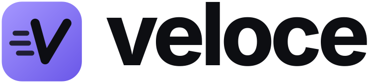

<p align="center">
  <picture>
    <source media="(prefers-color-scheme: dark)" srcset="docs/brand/veloce-lockup-dark.svg">
    
  </picture>
</p>

<p align="center">
  <strong>AI-first, open-source presentation engine.</strong><br>
  AI agents build professional, animated decks through an MCP server;<br>
  humans edit the very same deck by hand, even at the same time.
</p>

<p align="center">
  
  
  
  
  <a href="LICENSE"></a>
</p>

> **Alpha.** Veloce runs as a local web app today and decks are saved as `.veloce` files. The
> desktop app, motion graphics and export come next. See [docs/ROADMAP.md](docs/ROADMAP.md) for
> where things stand.

## Why Veloce

-  **AI-first, not AI-bolted-on:** the editor and AI agents use the exact same
  operations, so you can watch an agent build a deck live, edit alongside it, and undo only your
  own changes.
-  **Structure, not pixels:** slides are frames that lay themselves out (stacks and
  grids), so edits reflow instead of overlapping, and a theme restyles everything at once.
-  **Animated by design:** motion-graphics animation, from calm to absurd, without
  lag. You or your agent pick the level, and one deterministic timeline drives everything.
-  **Extensible:** element types come from plugins that follow one public contract.
-  **Your own format:** `.veloce` files are open, versioned zips you can keep and
  share.

## What works today

- **For agents (MCP):** build whole slides in one call, batch edits, themes, images, shapes,
  lines and arrows, drawings from SVG paths and SVG files imported safely, lint feedback after every change, slide
  previews, reusable components and slide layouts, sections, footers and slide numbers, slide
  transitions and morph, and undo of their own work.
- **In the editor:** slides, layers and an inspector; direct manipulation (move, resize,
  rotate, crop, snapping), auto layout and free layers; shapes (stars, polygons, arrows and
  more), lines and arrows drawn by their ends, and SVG pasted from design tools; rich text; themes, colors and
  gradients; images and fonts; a menu bar, command palette and Preferences; components and
  slide layouts; slide numbers, footers and sections; history with per-person undo; versions
  kept inside the file; and live lint.
- **Motion:** animations with motion levels (calm to absurd), effect presets, layout
  animations and stagger, Animate this slide or the whole deck from one pacing, slide
  transitions and morph, and Present.

## Quick start

Requires **Node 22+** and **pnpm** (version pinned in `package.json`).

```sh
pnpm install
pnpm start        # builds everything and serves the editor on http://127.0.0.1:4321
```

Decks live in `./decks`. Open <http://127.0.0.1:4321> to edit them.

**Connect Claude Code** (or any MCP client) to the running server:

```sh
claude mcp add --scope user --transport http veloce http://127.0.0.1:4321/mcp
```

Claude Code connects to MCP servers when a session starts, so start Veloce first, then open a
new Claude Code session and ask it for a deck. You'll see it appear in the editor as it's built.

## Documentation

| Read                                         | For                                                                   |
| -------------------------------------------- | --------------------------------------------------------------------- |
| [docs/ARCHITECTURE.md](docs/ARCHITECTURE.md) | How Veloce fits together: packages, data flow, where to start reading |
| [docs/DECISIONS.md](docs/DECISIONS.md)       | Every architectural decision and why it was made                      |
| [docs/ROADMAP.md](docs/ROADMAP.md)           | What's done, what's next, and what 1.0 means                          |

Agents learn Veloce from the MCP server itself (its instructions and `get_docs` topics). A
user guide, plugin developer docs and the `.veloce` format spec are planned before 1.0.

## Development

```sh
pnpm check        # lint + typecheck + test, the same as CI
pnpm build        # compile all packages (tsc -b)
pnpm test         # run tests (Vitest, no build needed)
pnpm test:watch
pnpm format       # auto-fix formatting & import order (Biome)

pnpm dev:server   # the server, allowing the Vite dev editor below
pnpm dev:editor   # the editor with hot reload on http://localhost:5173
```

Browser tests (`tests/integration/`) drive the real editor in headless Chromium. They need
`pnpm build:editor` and Chromium
(`pnpm --filter @veloce/server exec playwright-core install chromium-headless-shell`);
without them they skip locally. CI requires them.

`scripts/architecture.test.ts` enforces the package dependency graph. If it fails, either fix
the import or (if the architecture changed on purpose) update it and record a decision.

## Repository layout

| Path                  | What lives there                                                         |
| --------------------- | ------------------------------------------------------------------------ |
| `packages/core`       | Deck schema, ops, transactions, undo, theme tokens, lint rules (pure TS) |
| `packages/format`     | `.veloce` file read/write, assets, migrations, versions                  |
| `packages/plugin-api` | Plugin contract, registry, conformance kit                               |
| `packages/builtins`   | The built-in plugin set (text, shape, line, vector, image, effects)      |
| `packages/renderer`   | Deck → DOM rendering, layout, motion, measurement                        |
| `packages/images`     | Image optimization on import                                             |
| `packages/doc-server` | Document ownership, transactions, sync, autosave                         |
| `packages/mcp`        | MCP tools and docs for AI agents                                         |
| `apps/editor`         | The editor web app                                                       |
| `apps/server`         | Standalone doc-server + MCP + headless render worker                     |
| `apps/desktop`        | Electron desktop app (placeholder until Phase 7)                         |
| `plugins/*`           | Element-type plugins                                                     |

## License

[Apache License 2.0](LICENSE)
