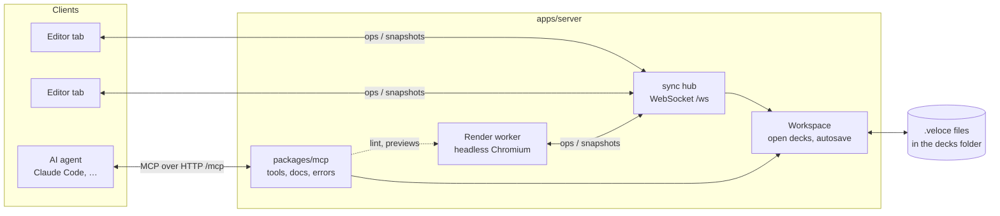
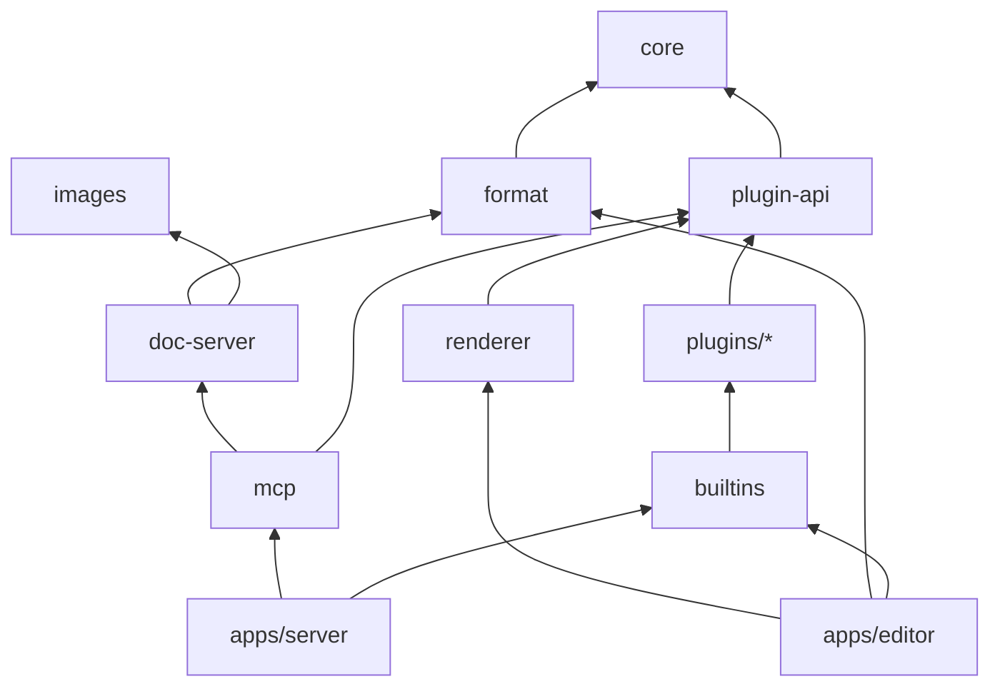

# Veloce architecture

A one-page map of how Veloce fits together. It explains **what** each part does and **how a
change flows**; the reasons behind each choice live in [DECISIONS.md](DECISIONS.md) (the `D`
numbers below), and what's next lives in [ROADMAP.md](ROADMAP.md).

## The big picture

One server owns every deck. The editor (any number of browser tabs) and AI agents (over
MCP) are both clients, and both change a deck the same way: by sending **ops** in a
**transaction**. There is no "AI mode" and no special path for humans.

## The golden rules

These hold everywhere; most design questions are answered by one of them.

1. **Humans and AI go through the same ops and transactions.** No special cases.
2. **The doc-server owns the document.** Editor tabs, agents and the render worker are clients.
3. **One timeline clock.** Plugins implement `seek(t)` and never run their own loop.
4. **Layout is structural.** Agents describe frames (stack, grid); the engine computes pixels.
5. **One Zod schema per element type** generates inspector UI, MCP input, validation and docs.
6. **Built-ins use the public plugin API**; third-party plugins run sandboxed (D79).
7. **Every op is invertible, and undo is per origin** (`user`, `agent:<id>`, `plugin:<id>`):
   Ctrl+Z never undoes an agent's work, and an agent's undo never touches yours.

## The document model (`packages/core`)

Pure TypeScript with no DOM and no Node APIs, used by every other package.

- **Deck** → **slides** → a tree of **nodes**. A node is a **frame** (lays out its children:
  `stack`, `grid` or `absolute`) or an **element** (a leaf drawn by a plugin: `text`,
  `shape`, `image`, …). Sizes are numbers, `"hug"` or `"fill"`. Schemas: `src/schema/`.
- **Theme tokens** (`$color.primary`, `$text.h1`, `$space.md`) keep decks consistent and
  restylable; built-in themes in `themes.ts`.
- **Assets** are content-hashed (SHA-256) files in the `.veloce` zip, referenced as
  `asset:<hash>`; never base64 in the document.
- **Components and slide layouts** (D94, D95): named templates in the deck, inserted as
  plain copies (`use` / `with`), so the rest of the system never sees them.
- **Morph match keys** (`morph.ts`, D109): a layer's key is its `matchKey`, else its ID;
  `morphPairs` says which layers of two slides are the same thing (by key, then name and
  type). Copies inherit their original's key.
- **Fields, the footer and sections** (`fields.ts`, D97): a text run can be a field (slide
  number, date…) whose value depends on where the slide is; the footer is deck settings
  drawn over every slide; a section is a marker on its first slide.
- **Animations** (`schema/animation.ts`, `timeline.ts`, D110): each slide's `animations`, in
  play order, with triggers that derive the steps (`scheduleSlide`); an effect or keyframe
  tracks on motion channels or the target's own properties.
- **2.5D** (D112): `perspective` on frames and `depth` on layers are document fields; the
  renderer draws them (`frameSpaceCss`, `drawnCss`), and the editor's gestures undo the
  depth's magnification (`toLayerSpace`).
- **Motion levels and tokens** (`schema/motion.ts`, `motion-tokens.ts`, D111): the theme's
  `$motion` values, scaled by the slide's or deck's level, resolve an animation's times and
  easings (`slideMotionTokens` → `scheduleSlide`).
- **Ops** (`src/ops/`): `slide.*`, `node.*`, `animation.*`, `deck.*`, `asset.*`, `component.*`. Each is
  plain JSON, validated, and returns its **exact inverse** when applied. Updates are JSON
  Merge Patches. Ops copy only the path to what changed (structural sharing), so untouched
  slides keep their object identity and renderers skip them.
- **Transactions** (`transaction.ts`): a label, an origin and a list of ops, applied all or
  nothing. **`DeckDocument`** (`document.ts`) adds per-origin undo/redo on top.
- **Errors** (`errors.ts`) are written to be acted on: a code, a message, a path and a hint
  ("Did you mean `title`?"), for people and agents alike.
- **Lint** (`lint.ts`) checks a deck for overflow, contrast, overlaps and more; visual rules
  use measurements from a real renderer.

## The file (`packages/format`)

A `.veloce` file is a zip: `manifest.json`, `document.json` (the deck), `assets/<hash>.<ext>`,
and `versions/<id>.json` (named copies, D93). Reading treats every file as untrusted: sizes
and paths are limited, every asset is hashed, documents are migrated to the current format
version and validated. A broken version is skipped, never fatal.

## The server (`packages/doc-server`, `apps/server`)

- **Workspace** (`workspace.ts`): the decks folder. Lists decks cheaply, opens them on
  demand, autosaves after a short pause (atomically), and sweeps asset bytes nothing can use
  (D65). One deck is "active": what the user sees and agents work on by default. Deleting
  a deck moves its file to `.trash/` in the folder (D99).
- **OpenDeck** (`open-deck.ts`): one live deck: a `DeckDocument` plus asset bytes, a version
  number and change events. Images are optimized on import (`packages/images`, D67).
- **Sync hub** (`sync-hub.ts`) speaks the protocol in `core/src/sync.ts` over `/ws`: a client
  opens a deck, gets a **snapshot**, then every committed change as the **ops** that made it,
  with a version. Applying them with core reproduces the server's deck exactly; a version
  gap asks for a new snapshot. The server stamps each transaction's origin, so a tab can't
  pose as an agent.
- **Settings** (`settings-store.ts`, D91): one user settings file the server owns,
  `~/.config/veloce/settings.json` (or the OS equivalent), pushed live to every tab.
- **`apps/server`** wires it together on `http://127.0.0.1:4321`: the editor, `/ws`, `/mcp`,
  `/api/…` (health, asset download and upload) and `/render.html`, plus the **render worker**
  (headless Chromium via playwright-core) that measures slides for lint and takes previews
  for agents with the same renderer the editor uses.

## Agents (`packages/mcp`)

Few, high-leverage, batch-friendly tools (`tools.ts`): `upsert_slide` builds a whole slide,
`apply_ops` batches any edits, plus deck, theme, asset, lint, preview, components and undo
tools. Agent input is friendlier than core's (`input.ts`: optional IDs, kinds and layouts,
`use` for components) and is normalized into plain ops before it reaches core.

- Every edit returns lint for the slides it changed; errors say how to fix the call.
- The docs agents read (`docs.ts`: server instructions plus `get_docs` topics) are partly
  generated from the live schemas and plugins, so they can't drift from the engine.
- Each agent connection is a session (D68): it has its own deck, may only rebuild slides it
  created, and hears what others changed since its last call (D71).

## Drawing (`packages/renderer`, `packages/plugin-api`, `plugins/*`)

- **Renderer**: deck → DOM. Frames become CSS flexbox, grid or positioned boxes
  (`layout.ts`); a stage is laid out at its real size (1920×1080) and scaled with a CSS
  transform, so text wraps the same at every zoom. Rendering is incremental, and a plugin
  that throws only breaks its own box. It hands elements the slide's field values and
  re-draws the ones that show them when those change, and draws the deck's footer over
  the slide (click-through, not a layer).
  **Motion** (D103) is drawn on top of layout: `setMotion` moves, turns, scales, fades and
  blurs layers from their rest position (core's `MotionState`) without re-running layout,
  and the renderer is the only writer of `transform`, `opacity` and `filter`. The timeline that
  produces motion will be our own evaluator in core; proven libraries only draw (D105).
- **Plugin API**: a plugin defines element types (a Zod props schema, defaults, `mount`,
  `update`, `seek`, `dispose`, and `aiDocs` for agents) and registers them in a registry that
  core uses to validate props. Every plugin passes the conformance kit. The built-in ones
  (`text`, `shape`, `image`) use the same public API (`packages/builtins` bundles them).

## The editor (`apps/editor`)

A React app (Vite) that is just another client of the server (`sync-client.ts`).

- **Pure models** in `src/model/` turn intent into ops (`commands.ts`, `insert.ts`,
  `clipboard.ts`, `components.ts`, …) and are unit-tested without a browser; components
  only render and send.
- **Commands** (`src/commands/`, D81, D89): every menu item, tool, shortcut and palette entry
  is one registry command with an `enabled` check, so the menu bar, the keymap and the
  command palette (D92) can't disagree. Third-party plugins will add commands to the same
  registry (Phase 6, D79).
- **Edits are optimistic previews, committed as transactions**: a drag shows on the canvas
  only (`preview.ts`) and sends one transaction when it ends, so one gesture is one undo step.

## Tests

`pnpm check` runs lint, typecheck and every test, the same as CI.

- **Unit tests** sit next to the code (`*.test.ts`, `__tests__/`), most of them on pure
  functions.
- **Acceptance tests** in `tests/integration/` drive the real built editor in headless
  Chromium against a real server, one file per roadmap feature (`phaseN-*.test.ts`). They
  need `pnpm build:editor` first; locally they skip without Chromium, and CI requires them.
- **Visual regression tests** in `tests/visual/` render frozen reference decks with the
  render worker and compare every slide pixel by pixel with stored screenshots (D102).
  After a deliberate visual change, review the diffs in `tests/visual/.output/` and run
  `pnpm test:visual:update`.
- **The motion performance test** (`tests/perf/motion/`, `pnpm perf:motion`, D107) plays a
  slide of hundreds of moving layers in GPU Chromium, through the main thread and through the
  compositor, and reads smoothness from Chrome's own frame reports. It depends on the
  machine, so it isn't part of `pnpm check`.
- **`scripts/architecture.test.ts`** enforces which package may depend on which. Changing
  the graph means updating it and recording why in DECISIONS.md.

## Package dependencies

`core` depends on nothing, ever. Plugins may only use `core` and `plugin-api`.

## Where to start reading

| To understand…                     | Read                                                                          |
| ---------------------------------- | ----------------------------------------------------------------------------- |
| what a deck is                     | `packages/core/src/schema/`                                                   |
| how a change is applied and undone | `core/src/ops/apply.ts`, `core/src/document.ts`                               |
| how tabs stay in sync              | `core/src/sync.ts`, `doc-server/src/sync-hub.ts`, `editor/src/sync-client.ts` |
| what agents can do                 | `packages/mcp/src/tools.ts`, `packages/mcp/src/docs.ts`                       |
| how a slide is drawn               | `renderer/src/slide-renderer.ts`, `renderer/src/layout.ts`                    |
| how to write an element plugin     | `plugin-api/src/types.ts`, `plugins/shape/src/index.ts`                       |
| an editor feature                  | its command in `editor/src/commands/`, then its model in `editor/src/model/`  |
